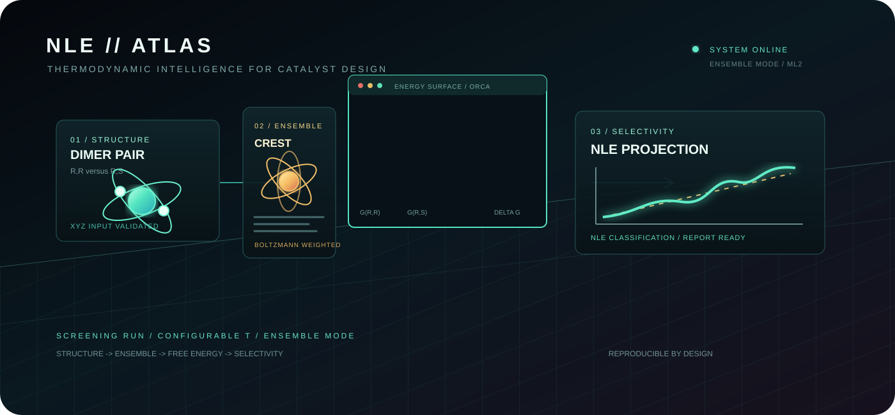

# NLE-Predictor

### Automated Non-Linear Effect (NLE) Predictors and Thermodynamic Intelligence for Asymmetric Catalysis

<p align="center">
  
</p>

<p align="center">
  <strong>A research-grade computational instrument and modeling engine for non-linear effects in chiral catalyst design.</strong><br>
  Conformer ensembles &bull; Free-energy surfaces &bull; Enantioselectivity forecasts &bull; Experimental data fitting
</p>

<p align="center">
  
  
  
  
  
  
</p>

---

## Overview

**NLE-Predictor** is an open-source, reproducible computational screening instrument designed to model, predict, and analyze **Non-Linear Effects (NLE)** in asymmetric synthesis and catalytic reaction design.

The package combines:
1. **Automated Quantum Chemistry Workflows:** CREST/xTB conformational sampling, DFT geometry optimization, and vibrational frequency analysis (ORCA / Gaussian) to calculate Boltzmann-weighted Gibbs free energies for homochiral (`R,R`) and heterochiral (`R,S`) catalyst dimers.
2. **Kagan ML2 Thermodynamic & Kinetic Engines:** Monomer-dimer equilibria solvers equipped with analytical Jacobians for instantaneous quadratic convergence across reservoir and active-dimer regimes.
3. **Experimental Parameter Fitting:** Non-linear least-squares regression to extract $\Delta G$, $K_{\text{hetero}}/K_{\text{homo}}$, and intrinsic monomer stereoselectivity ($ee_0$) with 95% confidence intervals directly from HPLC/GC enantiopurity data pairs.
4. **Mathematical Curve Diagnostics:** Quantifies initial slope at racemic state ($S_0$), maximum asymmetric amplification factor ($\alpha_{\text{max}}$), Area Under Asymmetry (AUA), and inflection points.
5. **Publication-Ready Visualization:** JACS/Nature-styled plots including dual-axis experimental overlays, residual subplots, and monomer speciation curves at 600 DPI.

<table>
  <tr>
    <td align="center"><strong>CONFORMER ENGINE</strong><br>CREST / xTB conformational sampling & Boltzmann weighting</td>
    <td align="center"><strong>QUANTUM CORE</strong><br>ORCA and Gaussian DFT frequency & free energy evaluation</td>
    <td align="center"><strong>KINETIC SOLVER</strong><br>Kagan ML2 Reservoir & Active Dimer models with analytical Jacobian</td>
    <td align="center"><strong>DATA REGRESSION</strong><br>Non-linear curve fitting for experimental $(ee_{\text{cat}}, ee_{\text{prod}})$ data</td>
  </tr>
</table>

---

## Chemical & Mathematical Foundation

In asymmetric catalysis, the enantiomeric excess of the product ($ee_{\text{prod}}$) often deviates dramatically from the catalyst enantiomeric excess ($ee_{\text{cat}}$) due to aggregation phenomena:

$$
C_R = M_R + 2 K_{\text{homo}} M_R^2 + K_{\text{hetero}} M_R M_S
$$

$$
C_S = M_S + 2 K_{\text{homo}} M_S^2 + K_{\text{hetero}} M_R M_S
$$

The relative dimerization stability $\Delta G = G_{(R,S)} - G_{(R,R)}$ determines the equilibrium association constants through statistical symmetry ($C_2$ rotational factor of 2):

$$
\frac{K_{\text{hetero}}}{K_{\text{homo}}} = 2 \exp\left(-\frac{\Delta G}{R T}\right)
$$

- **Positive NLE ((+)NLE, Asymmetric Amplification):** $\Delta G < 0 \implies K_{\text{hetero}} \gg K_{\text{homo}}$. The heterochiral dimer sequesters the minor enantiomer into an unreactive reservoir, boosting product optical purity.
- **Negative NLE ((-)NLE, Asymmetric Depletion):** $\Delta G > 0 \implies K_{\text{homo}} \gg K_{\text{hetero}}$. Homochiral dimers deplete the major enantiomer, reducing product optical purity.

For the full theoretical derivations, analytical Jacobians, active dimer kinetics, and standard-state concentration corrections, see [docs/THEORY.md](docs/THEORY.md).

---

## Installation & Portability

### Option A: Via Pip / PyPI Standard

```bash
git clone https://github.com/asifverse4/Automated-Non-Linear-Effect-NLE-Predictors.git
cd Automated-Non-Linear-Effect-NLE-Predictors
python -m pip install -e ".[dev]"
```

### Option B: Via Conda / Mamba Environment

```bash
conda env create -f environment.yml
conda activate nle-predictor
```

For a development and Jupyter-enabled environment:
```bash
conda env create -f environment-dev.yml
conda activate nle-predictor-dev
```

### Option C: Containerized Execution (Docker)

100% reproducible and isolated environment across all Linux, macOS, and Windows workstations or HPC clusters:

```bash
# Build the Docker image
docker build -t nle-predictor:latest .

# Run simulations via Docker
docker run --rm -v $(pwd)/calc_outputs:/workspace/calc_outputs nle-predictor simulate --delta-g -1.8 --outdir calc_outputs
```

### Automation & Task Runners

- **Linux / macOS:** Use `make test`, `make figures`, `make lint`, `make dev-install`.
- **Windows PowerShell:** Use `.\make.ps1 test`, `.\make.ps1 figures`, `.\make.ps1 dev-install`.

---

## Command Line Interface (CLI)

`nle-predictor` provides four specialized subcommands:

### 1. Quantum Chemistry Workflow (`run`)

Executes automated conformer search (CREST), ORCA DFT evaluations, Boltzmann ensemble weighting, and NLE curve generation:

```bash
# Real execution with CREST and ORCA
nle-predictor run \
  --rr inputs/dimer_RR.xyz \
  --rs inputs/dimer_RS.xyz \
  --solvent toluene \
  --cores 8 \
  --conformers 5 \
  --outdir calc_outputs

# Synthetic dry-run preview (no quantum chemistry execution)
nle-predictor run --rr inputs/dimer_RR.xyz --rs inputs/dimer_RS.xyz --dry-run

# Deterministic mock demonstration
nle-predictor run --mock --outdir calc_outputs --sensitivity
```

### 2. Fast Analytical / Kinetic Simulation (`simulate`)

Simulate and plot NLE trajectories instantaneously without quantum chemistry:

```bash
# Simulate asymmetric amplification with Delta G = -2.0 kcal/mol
nle-predictor simulate --delta-g -2.0 --khomo 1e5 --outdir sim_amplification

# Simulate active dimer kinetics with relative rate constant g = 0.5
nle-predictor simulate --delta-g -1.5 --g 0.5 --ee0 0.95 --outdir sim_active
```

Outputs include:
- `simulated_nle.csv`: Raw $ee_{\text{cat}}$ vs $ee_{\text{prod}}$ data.
- `simulated_curve.png`: 600 DPI publication curve.
- `monomer_speciation.png`: Active $[M_R]$, $[M_S]$ pool speciation.

### 3. Experimental Data Fitting (`fit`)

Fit experimental enantiopurity data pairs from chiral HPLC or GC to extract experimental thermodynamic parameters ($\Delta G$, $K_{\text{hetero}}/K_{\text{homo}}$, and intrinsic $ee_0$):

```bash
nle-predictor fit \
  --data examples/benchmarks/datasets/kagan_amplification.csv \
  --temp 298.15 \
  --outdir fit_kagan
```

Outputs:
- Fitted $\Delta G$ with standard error and 95% confidence interval.
- Fitted $K_{\text{ratio}} = K_{\text{hetero}}/K_{\text{homo}}$.
- Coefficient of determination ($R^2$) and Root Mean Square Error (RMSE).
- `fitted_nle_curve.png`: Dual-panel figure with experimental scatter points, fitted curve, and residual distribution.
- `fit_summary.json`: Machine-readable provenance.

### 4. Mathematical Diagnostics (`diagnostics`)

Calculate initial slope $S_0$, maximum amplification factor $\alpha_{\text{max}}$, Area Under Asymmetry (AUA), and curvature inflection points:

```bash
nle-predictor diagnostics --data examples/benchmarks/datasets/kagan_amplification.csv
```

---

## Python API Usage

`nle-predictor` can be imported directly into Python scripts, workflows, or Jupyter notebooks:

```python
import numpy as np
from nle_predictor import (
    NLECalculator,
    KaganActiveDimerModel,
    fit_kagan_reservoir,
    analyze_nle_diagnostics,
    plot_nle_with_experimental,
)

# 1. Simulate Kagan ML2 Reservoir Model
calc = NLECalculator(temp=298.15)
cat_ee = np.linspace(0.0, 1.0, 101)
result = calc.simulate(cat_ee, delta_g_kcal=-1.8, k_homo=1e5)

print(f"Classification: {result.classification}")
print(f"Product ee at 50% catalyst ee: {result.product_at_50 * 100:.2f}%")

# 2. Extract Mathematical Diagnostics
diag = analyze_nle_diagnostics(result.ee_catalyst, result.ee_product)
print(f"Initial Slope S_0: {diag.initial_slope:.3f}")
print(f"Max Amplification: {diag.max_amplification:.3f}x")

# 3. Fit Experimental Data
exp_cat = np.array([0.05, 0.15, 0.30, 0.50, 0.70, 0.90])
exp_prod = np.array([0.28, 0.61, 0.82, 0.92, 0.96, 0.99])
fit_res = fit_kagan_reservoir(exp_cat, exp_prod)
print(f"Fitted Delta G: {fit_res.delta_g_kcal:.3f} ± {fit_res.delta_g_stderr:.3f} kcal/mol")
print(f"R^2: {fit_res.r_squared:.4f}")

# 4. Generate Publication Plot
plot_nle_with_experimental(result, exp_cat=exp_cat, exp_prod=exp_prod, save_path="nle_paper_fig.png")
```

---

## Benchmark Chemical Systems

The repository includes curated chemical geometries and historic literature datasets in `examples/benchmarks/`:

- **Structures (`examples/benchmarks/structures/`):**
  - `dimer_RR.xyz`: $C_2$-symmetric homochiral bis-(aminoalcoholate)-di-zinc catalyst complex.
  - `dimer_RS.xyz`: $C_i$-symmetric heterochiral meso dimer complex.
- **Literature Datasets (`examples/benchmarks/datasets/`):**
  - `kagan_amplification.csv`: Historic Kagan diethylzinc addition showing profound (+)NLE.
  - `blackmond_aldol.csv`: Blackmond proline-catalyzed asymmetric aldol reaction.
  - `negative_depletion.csv`: Representative dataset displaying asymmetric depletion ((-)NLE).

---

## Project Structure

```text
Automated-Non-Linear-Effect-NLE-Predictors/
|-- src/
|   `-- nle_predictor/
|       |-- core/             # Physical constants, CODATA, types, XYZ Kabsch RMSD
|       |-- thermo/           # Boltzmann weighting, partition functions, entropy
|       |-- models/           # Kagan ML2 Reservoir, Active Dimer, diagnostics
|       |-- fitting/          # Non-linear regression and parameter estimation
|       |-- qc/               # CREST, ORCA, and Gaussian parsers & runners
|       |-- viz/              # JACS-quality visualization, speciation, contour maps
|       `-- cli.py            # Unified command-line interface
|-- examples/
|   `-- benchmarks/           # Chemical dimer XYZ structures and experimental CSVs
|-- tests/                    # Comprehensive unit and integration test suite (28+ tests)
|-- docs/
|   `-- THEORY.md             # Complete theoretical derivations and mathematical proofs
|-- pyproject.toml            # PEP 517/621 packaging metadata
|-- CITATION.cff              # Machine-readable Citation File Format
|-- CITATION.md               # Research citation instructions
|-- README.md                 # Project documentation
`-- LICENSE                   # MIT License
```

---

## Citation & Standards

If this software contributes to published research, please cite:

```bibtex
@software{raza_nle_predictor_2026,
  author    = {Raza, Asif},
  title     = {{NLE Predictor: Automated Non-Linear Effect Predictors and Thermodynamic Intelligence for Asymmetric Catalysis}},
  year      = {2026},
  version   = {1.0.0},
  url       = {https://github.com/asifverse4/Automated-Non-Linear-Effect-NLE-Predictors}
}
```

- [Contributing Guidelines](CONTRIBUTING.md)
- [Code of Conduct](CODE_OF_CONDUCT.md)
- [Theoretical Manual](docs/THEORY.md)
- [MIT License](LICENSE)
